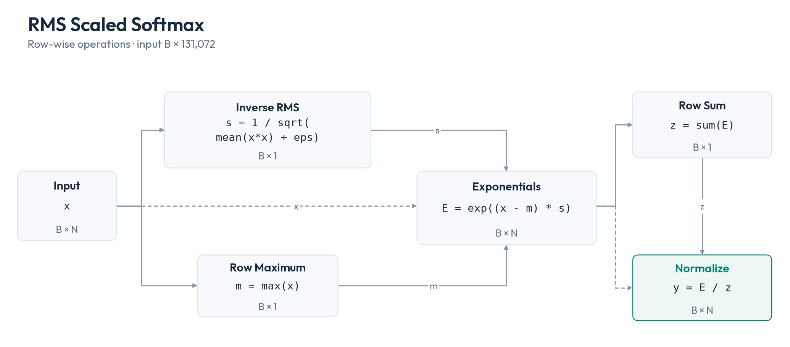
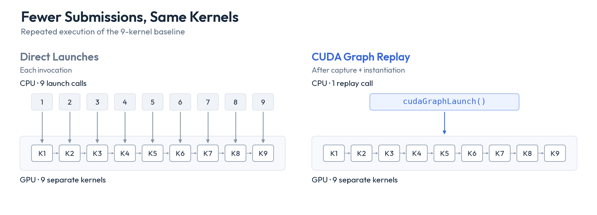
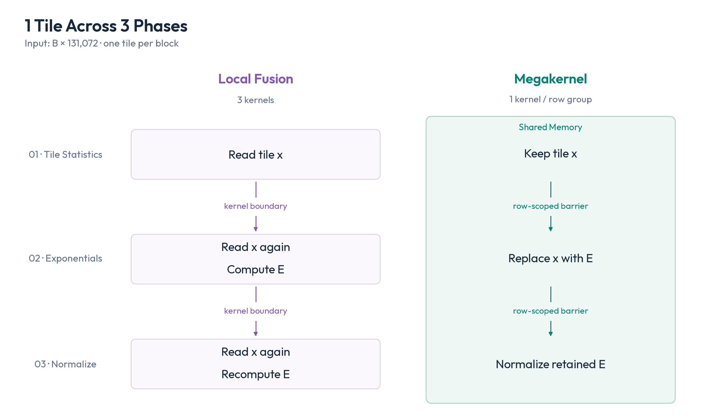
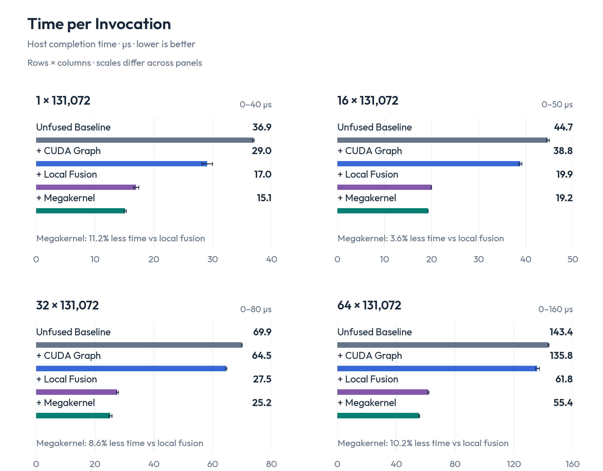
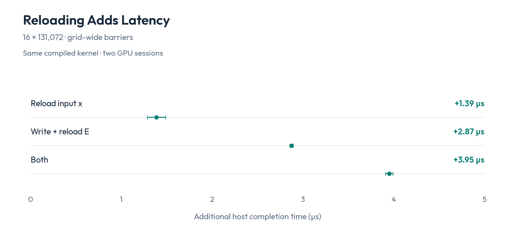

# CUDA Graphs, Fusion, and Megakernels

CUDA Graphs reduce launch overhead. When is a megakernel still worth the complexity?

CUDA Graph replay can reduce the overhead of submitting a repeated GPU workflow. However, it leaves the kernels and their intermediate tensors intact. Fusion can avoid some of those writes and reads, but it must preserve the order of dependent operations. In an ordered kernel chain, each kernel finishes before the next starts. If we fuse the chain into a megakernel, how do thread blocks wait for the results they need from other blocks? In this post, we’ll use RMS-scaled softmax as a toy example to compare and understand the progression: unfused baseline → CUDA Graph replay → local fusion → megakernel.

## A Toy Example with Two Synchronization Points

Start with a 2D tensor `x` of shape `(B, N)`: `B` rows and `N` elements per row. For each row, compute `sqrt(mean(row * row) + eps)`, divide the row by that number, then apply softmax.

```python
import torch
from torch import nn


def scaled_softmax(x, scale):
    exp_scores = (
        (x - x.amax(dim=-1, keepdim=True)) * scale
    ).exp()
    return exp_scores / exp_scores.sum(dim=-1, keepdim=True)


class RmsScaledSoftmax(nn.Module):
    def __init__(self, eps=1e-5):
        super().__init__()
        self.eps = eps

    def forward(self, x):
        # x: (B, N); inv_rms: (B, 1)
        inv_rms = torch.rsqrt(
            x.square().mean(dim=-1, keepdim=True) + self.eps
        )
        return scaled_softmax(x, inv_rms)


model = RmsScaledSoftmax()
x = torch.randn(16, 131_072)
y = model(x)  # (16, 131_072)
```



*All reductions operate row by row. Boxes show mathematical operations and tensor shapes, not GPU kernels. Here `s` is `inv_rms` and `E` is `exp_scores`. Dashed edges carry `x` or `E` directly to later operations.*

The module defines the compute semantics without fixing kernel boundaries. We compare 4 GPU implementations of that computation: an unfused baseline, CUDA Graph replay, local fusion and a megakernel.

The [benchmark configuration](evidence/rms-softmax/code/config.json) uses wide rows (`N = 131_072`, or `2**17`) to distribute each row across many thread blocks, and tests `B = 1, 16, 32, 64`.

We split each row into contiguous tiles, with one tile per thread block. Blocks processing the same row synchronize at two points:

1. **Before exponentials:** all tiles must finish computing their sums of squares and maxima. Each block then combines these into the row’s inverse RMS and maximum.
2. **Before normalization:** all tiles must finish computing their exponential sums. Each block then adds these sums to get the softmax denominator.

Local fusion uses ordered kernel launches for this synchronization. The megakernel uses barriers inside 1 kernel.

The [unfused baseline](evidence/rms-softmax/code/bench.cu) uses 9 kernels to compute squares, tile and row statistics, exponentials, their sums, and normalization. This is a deliberately unfused baseline, not a tuned framework implementation.

## 1. CUDA Graphs: Reduce Repeated Submission Overhead

[Capture the baseline’s 9 launches](evidence/rms-softmax/implementation.html#cuda-graph-capture-and-replay) and instantiate the resulting CUDA Graph. Each replay then submits the chain with 1 `cudaGraphLaunch` call.

Each ordinary kernel launch requires driver work to prepare its execution. [Graph instantiation](https://docs.nvidia.com/cuda/archive/12.8.1/cuda-c-programming-guide/index.html#cuda-graphs) performs much of this preparation ahead of time, allowing subsequent replays to reuse it.



*The same 9 kernels and intermediate tensors remain. Boxes and arrows show submission and execution order, not timing.*

The CPU can enqueue later kernels while earlier kernels execute, hiding some submission overhead. Reducing CPU submission work therefore need not shorten completion time by the same amount. Graphs can also [reduce launch and dependency overhead on the GPU](https://developer.nvidia.com/blog/constant-time-launch-for-straight-line-cuda-graphs-and-other-performance-enhancements/).

Replay leaves these kernel bodies unchanged. A later kernel cannot inherit a completed kernel’s registers or shared-memory contents.

For 16 rows, [host completion time](evidence/rms-softmax/results.html#article-comparison) drops from **44.7 to 38.8 µs**. This includes submission and waiting for GPU completion.

## 2. Local Fusion: Combine Work within Each Phase

Local fusion reduces the baseline from 9 kernels to 3. The first writes each tile’s sum of squares and maximum to global memory. In the second, each block combines its row’s tile statistics, computes exponentials and writes their tile sum. In the third, each block combines those sums into the softmax denominator and normalizes its output tile.


*Gray boxes are baseline kernels; purple boxes are fused kernels. Arrows between fused kernels carry small statistics through global memory. Full `x²` and `E` tensors are no longer written; the last kernel recomputes `E`. Symbols match Figure 1. Box sizes do not represent execution time.*

These 3 kernels execute in stream order: all blocks of each kernel finish before the next kernel starts. We capture this chain in a CUDA Graph too, submitting it with 1 replay call.

For 16 rows, local fusion brings host completion time to **19.9 µs**. Can keeping tiles across phases save enough time to justify synchronization inside the kernel?

## 3. Megakernel: Keep Tiles in Shared Memory

Our [**megakernel**](evidence/rms-softmax/implementation.html#megakernel-and-row-barrier) extends fusion across the remaining 2 kernel boundaries. It executes all 3 phases for its assigned rows in 1 cooperative launch, so the same blocks and their shared-memory tiles survive across phases. Explicit barriers enforce the dependencies. Each block owns one tile throughout:

1. Load a tile of `x` into shared memory. Compute the tile’s sum of squares and maximum.
2. Wait for all tiles’ statistics for the row, then combine them to obtain the row maximum and inverse RMS. Overwrite the shared-memory tile with exponentials and compute their sum.
3. Wait for all tiles’ exponential sums for the row, then add them to get the softmax denominator. Divide the retained exponentials by that denominator and write the output.



*The continuous green region represents one block’s shared-memory buffer, reused for input values and then exponentials across two row-scoped barriers. Small statistics still use global memory. This row-scoped variant is used for 16–64 rows in the main comparison; the single-row measurement uses grid-wide barriers. The schematic shows storage, not measured timing.*

Grid-wide barriers wait for every block in the launch. Row-scoped barriers wait only for blocks processing the same row, so independent rows need not reach each phase together. Our row-scoped barrier uses device-scope release/acquire atomics to make each block’s statistics visible before other blocks consume them.

Blocks waiting at a barrier still occupy registers and shared memory; if the blocks they need cannot run, the kernel can deadlock. We therefore [cap each cooperative launch](https://docs.nvidia.com/cuda/archive/12.8.1/cuda-c-programming-guide/index.html#grid-synchronization-cg) at the kernel’s active blocks per SM multiplied by the GPU’s SM count. Larger inputs are split into row groups that fit this limit.

## What the H100 Measurements Show

We measured repeated execution on H100 80 GB GPUs (CUDA 12.8.1), using the same input after warmup. We time one invocation from submission until stream synchronization returns. Graph capture, instantiation, first-launch upload and data transfers are excluded.

The megakernel uses graph replay, with grid-wide barriers for one row and row-scoped barriers for 16–64 rows. The 64-row case is split across 2 launches to fit the cooperative launch limit.



*Host completion time in µs; lower is better. Bars average two session medians; whiskers span them. Compare methods within each panel: axis ranges differ. Percentages show the megakernel’s latency reduction from local fusion. The “+” labels mark successive optimizations; graph replay stays enabled.*

At 16 rows, the megakernel brings host completion time to **19.2 µs**, a further **3.6%** reduction from local fusion.

With a single megakernel launch, there are no internal kernel launches left for a graph to batch. Graph instantiation can still prepare launch work in advance, but replay need not reduce completion time: at 16 rows, direct launch averages **18.6 µs**, versus **19.2 µs** through its graph. We keep graph replay in the main comparison to hold the submission method fixed across the fusion steps. A larger workflow containing other kernels or copies may still benefit from a graph.

In a separate experiment at 16 rows, runtime switches add input reloads, writes and rereads of exponentials through global memory, or both, to one compiled grid-wide megakernel. This tests retention within that implementation; it does not break down the preceding local-fusion comparison. Tile size, launch count, register count and shared-memory allocation stay fixed:



*Extra host completion time when reloading values instead of keeping them in shared memory. Dots average the two sessions’ median penalties; whiskers span them.*

Reloading the input adds **1.39 µs**; writing exponentials to global memory and reading them back adds **2.87 µs**. Each control copies the reloaded values into shared memory and adds block-level synchronization. The measured penalties therefore include these operations too; they do not isolate global-memory access cost.

These results cover warm invocation latency at one row width on H100. Application speedups and other GPUs need separate measurements. The [full results and methods](evidence/rms-softmax/results.html) include per-session timings, both barrier variants, direct launches and slower candidates.

## When Is the Extra Control Worthwhile?

For 16 rows, graph replay with local fusion reduces host completion time from **44.7 to 19.9 µs**. The megakernel saves a further **0.7 µs**, reaching **19.2 µs** with graph replay. It loads `x` once and keeps `E` for normalization, instead of rereading `x` and recomputing `E` across kernels. That additional saving is what must justify the synchronization and launch-size handling.

Agents can automate parts of [writing, testing and refining kernels](https://arxiv.org/abs/2502.10517v1), potentially making megakernels cheaper to explore. The resulting speedup still needs to justify their synchronization and maintenance complexity.
