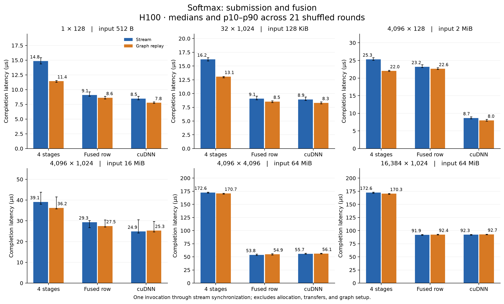
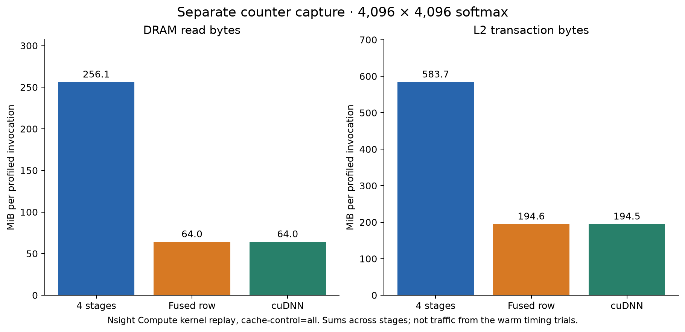
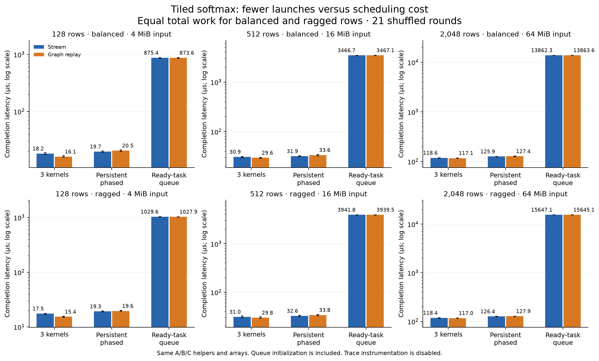
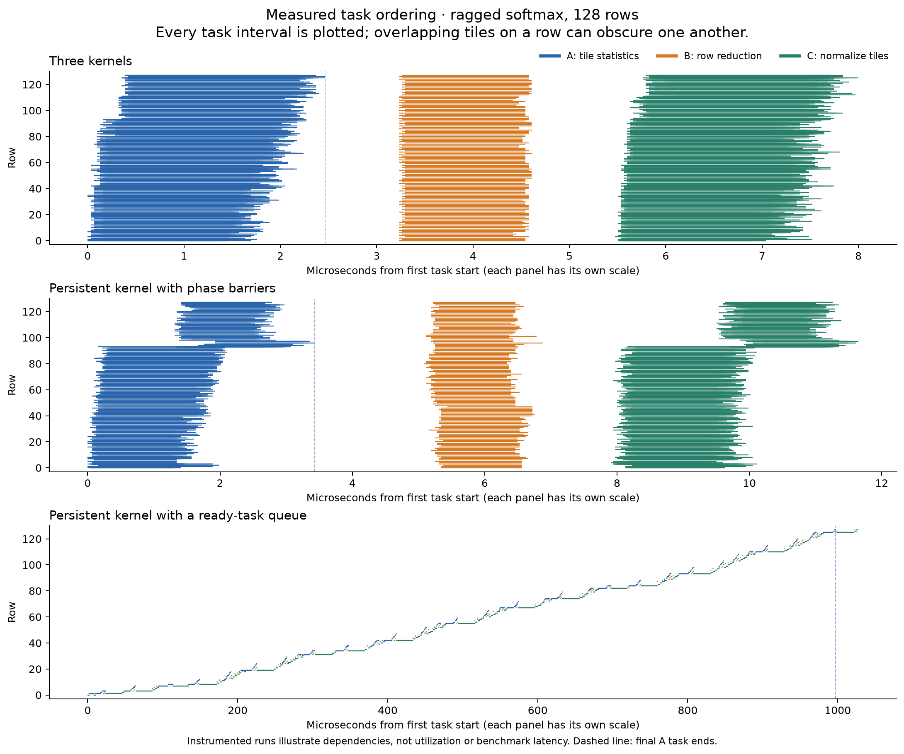

# H100 softmax experiments: evaluation and evidence

Run `20261019T175825Z`, measured October 19, 2026. These are research results for the unpublished article; its original February 22 date is unchanged.

The article's new four-way figures use these same raw samples. In the full-sweep figures below, **4 stages / Stream** (row example) and **3 kernels / Stream** (tiled example) are the ordinary-launch baselines. Fusion and megakernel-style scheduling are complementary to graph replay, not successive guaranteed speedups.

## Evaluation

**Use row softmax as the main worked example.** It has meaningful reductions and temporary arrays, a recognizable purpose, and a cuDNN reference. The old pointwise example remains a valid minimal sanity check. Repeated `float32(...)` casts are not the mechanism being illustrated: specify FP32 arithmetic once, then explain the operations.

The tiled example adds real cross-block fan-in and fan-out, equal-total-work balanced/ragged cases, and a persistent control with full phase barriers. It removes the earlier artificial occupancy reservation. Its centralized ready-task queue is a deliberately small runtime demonstration and is unsuitable as evidence that an optimized model-scale megakernel would be faster. The measured queue implementation is much slower. A hand-written MLP would introduce GEMM/Tensor Core implementation quality before cleanly separating these mechanisms.

## H100 is sufficient

The run used an **NVIDIA H100 80GB HBM3**, compute capability **9.0**, **132 SMs**, and **50 MiB L2**. CUDA compilation, graph capture/replay, cooperative grids, device atomics, and both profiler captures succeeded. The largest input is 64 MiB; capacity is ample, and that input exceeds this device's L2 size. No Blackwell-specific feature is required. `H100!` prevented Modal's automatic H200 upgrade. [Modal GPU selection](https://modal.com/docs/guide/gpu), [Hopper guide](https://docs.nvidia.com/cuda/hopper-tuning-guide/index.html).

## Row softmax: a benefit beyond replay

Compute `m = max(x)`, `e = exp(x-m)`, `z = sum(e)`, and `y = e/z` for each row. Compare four explicit kernels, one fused row kernel, and cuDNN accurate softmax. Each is tested with stream calls and graph replay; observed graph kernel counts are 4, 1, and 1 respectively.

All table entries are median **host completion latency in µs**, from submission through stream synchronization. There are 21 shuffled rounds per variant. Allocation, transfers, graph setup, validation, and profiling are excluded. Graph setup and first replay are recorded separately.

| Rows × columns | Staged stream | Staged graph | Fused graph | cuDNN graph |
|---|---:|---:|---:|---:|
| 1 × 128 | 14.84 | 11.44 | 8.62 | 7.77 |
| 32 × 1,024 | 16.21 | 13.06 | 8.54 | 8.31 |
| 4,096 × 128 | 25.32 | 22.01 | 22.61 | 7.98 |
| 4,096 × 1,024 | 39.11 | 36.25 | 27.51 | 25.27 |
| 4,096 × 4,096 | 172.60 | 170.75 | 54.93 | 56.08 |
| 16,384 × 1,024 | 172.60 | 170.34 | 92.39 | 92.74 |

At 4,096 × 4,096, replay changes the staged median from **172.60 to 170.75 µs**; the fused graph takes **54.93 µs**, close to cuDNN's **56.08 µs**. Fusion changes kernel count and intermediate storage together, so these timings do not isolate either contribution.

The narrow-row case is equally important: at 4,096 × 128, our fused graph takes **22.61 µs** versus cuDNN's **7.98 µs**. This generic fused kernel is not a shape-tuned library implementation. Its recorded 53 registers/thread and four resident blocks/SM differ from the separate kernels' resources; the timings alone do not establish the cause of the performance gap. No local memory was reported for the custom kernels.

The separate Nsight Compute capture recorded approximately **256 MiB DRAM reads for the four stages versus 64 MiB for fusion**. It uses kernel replay with `cache-control=all`; these are counter measurements under that policy, not traffic measurements from the warm latency trials. They must not be used to derive warm-run bandwidth or attribute all of the speedup to HBM traffic.

## Tiled softmax: earlier consumers can still lose

A computes each tile's maximum and shifted exponential sum. B combines all tile summaries for one row. C normalizes that row's tiles. A/B/C use the same helpers and global intermediates in all implementations.

Balanced rows contain 8,192 elements. Ragged rows contain one 36,864-element row and seven 4,096-element rows per eight, with a seeded permutation. Thus both distributions have the same number of elements, tiles, and row tasks. Workers prefer ready B/C tasks and claim new A tiles when the queue is empty. This consumer preference was chosen before GPU execution; no measured result informed it.

The persistent variants use the same compiled kernel and 792 workers. The phased version retains cooperative grid barriers. The queue version uses acquire/release publication, producer counters, and exact completion counts. Queue initialization is included in its measurements: graph kernel counts are **3 separate**, **1 phased**, and **2 queued**. These controls expose costs, but do not isolate atomics, worker assignment, resource allocation, and cache effects individually.

| Rows | Distribution | Separate graph | Phased persistent graph | Ready-task queue graph |
|---:|---|---:|---:|---:|
| 128 | balanced | 16.09 | 20.53 | 873.57 |
| 128 | ragged | 15.37 | 19.62 | 1027.87 |
| 512 | balanced | 29.62 | 33.64 | 3467.07 |
| 512 | ragged | 29.75 | 33.84 | 3939.48 |
| 2,048 | balanced | 117.14 | 127.38 | 13863.57 |
| 2,048 | ragged | 116.98 | 127.89 | 15645.09 |

For the ragged 128-row graph trace (fixture 2), **126 of 128 B tasks** and **980 of 1,024 C tasks** began before the last A task ended. Every B still waited for its own A producers, and every C waited for its B. Separate and phased variants had no such early starts. Yet uninstrumented completion was **15.37 µs separate**, **19.62 µs phased**, and **1,027.87 µs queued**. Earlier readiness is not enough to pay for this runtime. This is a negative result about this implementation and workload, not a result about megakernels in general.

Each timeline panel has its own time scale. It shows all task intervals, including overlapping tiles on a row; it is not an SM-utilization chart. Trace instrumentation is disabled in timing runs. Traced and untraced persistent builds both used 792 workers in this run.

## Validation and measurement limits

- **360 saved outputs** passed independent FP64 stable-softmax references, finite/nonnegative checks, and row-sum checks; **768 intermediate arrays** also passed. Tolerances were fixed before execution: `abs(error) <= 1e-7 + 2e-5 * abs(reference)`, and row sums within `2e-5` of one. Maximum observed output error was `5.43e-7`, rounded upward.
- All stream/graph pairs were bitwise equal. All scheduling variants were also bitwise equal to one another. Fixtures changed input values while graph pointers stayed fixed; the `(7,781)` case checked masking.
- Compute Sanitizer memcheck passed for row and DAG cases; synccheck passed for the DAG case. All **24 traces / 52,224 task intervals** passed coverage, visit-count, and dependency-order checks.
- **1,512 variant timing records**, plus **252 empty-synchronization baselines**, retain raw samples. Each record includes single completion, batch enqueue/completion, and event interval measurements. Baselines are not subtracted. Event intervals can include host-starvation gaps.
- Two Nsight Systems reports each contained 12 kernel intervals, including six graph-node intervals. Five Nsight Compute reports contained the expected 4/1/1 row kernels and 3/2 tiled kernels. CSV units were explicitly exported in base units. The installed Compute version writes `.ncu-repz`; offline exports are preserved separately.
- These are results from one H100 allocation. Clocks were recorded rather than locked; host completion depends on the host/runtime environment. Quantile bars describe these repeated samples, not population confidence intervals. The GPU function elapsed time was 507 seconds, including validation and artifact writes.

## Files and reproduction

- [Protocol](protocol.html), [captured CUDA source](code/bench.cu), [independent analyzer](code/analyze.py), [configuration](artifacts/config.json).
- [All timing summaries](timings.csv), [trace validation](trace-validation.json), [figure provenance](figure-provenance.json), [complete run summary](artifacts/summary.json).
- [Profiler exports and source hashes](profile-summary.json), [raw artifact manifest](artifacts/manifest.json).
- Four figures are available as PNG and SVG. Raw timings, trace CSVs, graph DOTs, compiler logs, PTX/SASS, hardware/library metadata, inputs, outputs, and original profiler captures are retained.

The raw run contains **1,741 hashed files / 9.37 GB** in Modal Volume `cuda-graphs-softmax-evidence`, directory `/20261019T175825Z/`. The compact local review explicitly lists omitted large arrays. The profiler-export supplement has its own manifest. Full data are retained remotely because local free disk space is smaller than the archive.

From the repository root, `.venv-modal/bin/modal run experiments/graphs_softmax/modal_app.py` repeats the bounded GPU experiment. `profile_exports.py --run-id 20261019T175825Z` exports existing profiler captures on CPU; `analyze.py PATH --review` verifies a review bundle; `report.py PATH` regenerates figures and tables from raw samples. The postprocessing fix for compressed Nsight reports did not change any GPU kernel, timing, or validation result.
